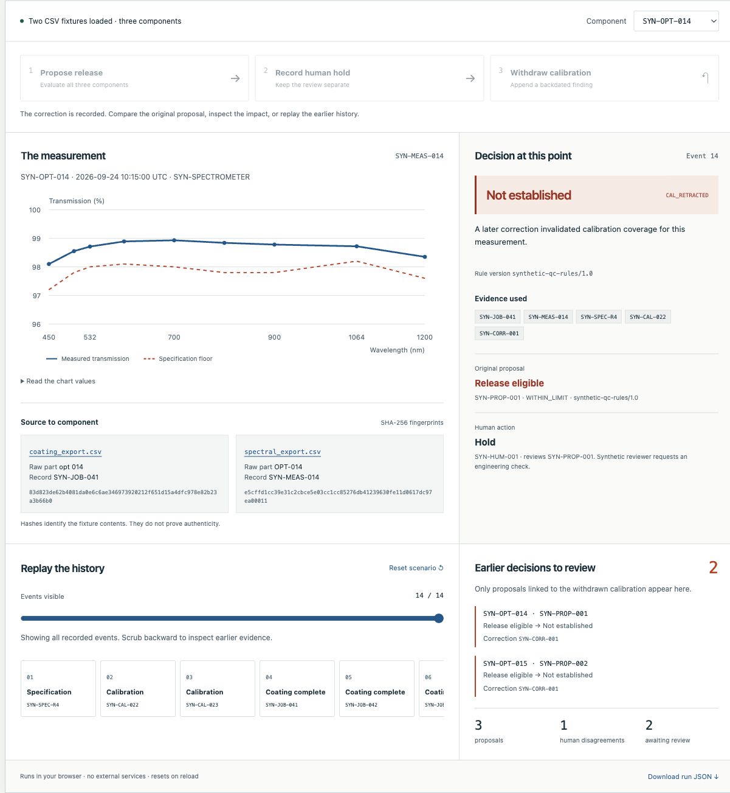

# Decision Replay

[](https://github.com/dziugasmarcenas-ui/decision-replay/actions/workflows/check.yml)

**Replay quality decisions when their supporting evidence changes.**

A synthetic optical measurement meets its specification. A reviewer records a hold. A later finding invalidates the calibration used for that measurement. The original proposal stays intact, current eligibility changes, and the affected earlier proposals are identified for review.

**[Open the interactive demo](https://dziugasmarcenas-ui.github.io/decision-replay/)** · [Watch the walkthrough](docs/demo.mp4) · [Architecture and tradeoffs](docs/architecture.md)



## Try it in a minute

1. Click **Propose release**. The rules evaluate three components: two are eligible and one is below an invented limit.
2. Click **Record human hold** for `SYN-OPT-014`. That action links to its proposal without overwriting it.
3. Click **Withdraw calibration**. Two earlier proposals now need review. The measured curve has not changed.
4. Scrub the event history backward. Before the correction, the same evidence supported the original proposal.
5. Select `SYN-OPT-016`. Its calibration is unaffected; it still receives a measurement-based hold.

All records, identifiers, limits and reviewer actions are invented. This is a standalone educational demonstration reduced from a larger personal prototype. It contains no customer records, equipment integration or production control.

## Run locally

Requires **Node.js 22 or later**. There are no runtime or development package dependencies, API keys, accounts or external fonts.

```sh
git clone https://github.com/dziugasmarcenas-ui/decision-replay.git
cd decision-replay
npm start
```

Open <http://127.0.0.1:8789>. Set `PORT=8790 npm start` to use another port. Use an HTTP server: opening `index.html` directly cannot load its fixtures reliably.

```sh
npm test         # domain regressions and delivery integration tests
npm run build    # explicit runtime allowlist → dist/
npm run check    # tests, then static build
```

No dependency installation is needed to run the project. CI uses `npm ci --ignore-scripts` to verify the lockfile and checks Node 22 and 24. The browser needs native ES modules, Web Crypto and `structuredClone`; use a current Chrome, Firefox, Edge or Safari. Local browser verification used Chromium; the other browser engines have not been verified.

## Review the code

| Entry point | What to inspect |
| --- | --- |
| [`src/engine.js`](src/engine.js) | CSV validation, alias normalization, pure replay, eligibility, proposal snapshots, human links and correction impact |
| [`tests/engine.test.js`](tests/engine.test.js) | Missing and mismatched evidence; proposal preservation; targeted impact rather than unrelated state changes |
| [`tests/validation.test.js`](tests/validation.test.js) | Explicit time zones, invalid calendar dates, empty limits, malformed CSV, immutable input and every replay prefix |
| [`src/app.js`](src/app.js) | Presentation derived from the engine; writes disabled in historical views; JSON export |
| [`scripts/public-files.mjs`](scripts/public-files.mjs) | Exact list of files allowed into the static deployment |
| [`tests/delivery.test.js`](tests/delivery.test.js) | Build contents, HTTP delivery and refusal to serve private or unrelated paths |

The interesting boundary is `release` versus `abstain`: a passing number alone cannot establish eligibility when its evidence is missing or invalid. In the interface, these are labelled **Release eligible**, **Hold**, and **Not established**. A proposal is advisory; even release eligibility never overrides a human hold.

## Data flow

```text
coating_export.csv ─┐
spectral_export.csv ├─ validate + normalize ─ event log ─ replay ─ eligibility
reference.json ────┘                            │                    │
                                               ├─ proposal snapshot ┘
                                               ├─ linked human action
                                               └─ later correction ─ affected proposals
```

The importer resolves `opt 014` and `OPT-014` to `SYN-OPT-014`. Source filenames, raw identifiers and SHA-256 fingerprints remain attached. A proposal records its evidence IDs, result and rule version. Replay uses an explicit prefix of the log, so a correction can change the current interpretation without changing an earlier proposal.

## Deliberate limits

- This models one small optical QC workflow, not a general manufacturing or event-sourcing platform. Input schemas and aliases are deliberately fixed.
- The event log lives in browser memory and resets on reload. Downloaded JSON is an inspection artifact; it cannot be imported back as a trusted log.
- Append-only behaviour is an application convention, not tamper resistance. Hashes identify content; they are not signatures or proof of origin.
- Calibration is matched by an invented instrument **class**, not a uniquely authenticated physical instrument. A production system would need stronger identity and authorization.
- Actions use fixed scenario timestamps. Replay follows append order; calibration coverage and correction scope use measurement time. No wall-clock expiration or equipment telemetry is implied.
- A human disagreement is a comparison, not an accuracy label. The fixtures and tests are authored examples, not an independent evaluation or proof of metrology validity.

See [architecture](docs/architecture.md) for the event contract, time model, testing rationale and production gaps. See [verification](docs/verification.md) for the checks performed on this release.

## Deployment

The `Deploy demo` workflow runs tests, builds only the allowlisted runtime files and deploys `dist/` to GitHub Pages. Repository documentation, media, tests, scripts and Git history are outside that site artifact. The public repository itself contains the selected source, tests and documentation.

## License

[MIT](LICENSE).
